# TP3-DAR2026 — Développement d'Applications Réparties en Java

## Informations générales

| Élément | Description |
|---|---|
| **Projet** | TP3-DAR2026 |
| **Module** | Développement d'Applications Réparties |
| **Étudiant(e)** | Salima Fourati |
| **Groupe** | LSI 3 — 2TP2 |
| **Année universitaire** | 2026–2027 |
| **Langage** | Java |
| **JDK** | 25.0.2 |
| **IDE** | IntelliJ IDEA |
| **Protocole de communication** | TCP |

---

# 1. Introduction

Ce TP a pour objectif de mettre en pratique les principaux concepts de la programmation des applications distribuées en Java.

Il est composé de deux activités complémentaires :

- **Activité 3-1 :** Développement d'un serveur TCP multithread permettant de gérer plusieurs clients simultanément et d'assurer un échange de messages.
- **Activité 3-2 :** Intégration d'un service de calculatrice utilisant la communication par objets Java et gestion des accès concurrents à une ressource partagée.

Ces activités permettent d'étudier les sockets TCP, la communication client-serveur, la programmation multithread, la sérialisation des objets et la synchronisation des threads.

# 2. Activité 3-1 : Développement d'un serveur TCP multithread

## 2.1. Objectif

L'objectif de cette activité est de développer un serveur TCP capable d'accepter plusieurs connexions clientes simultanément.

Chaque client est pris en charge par un thread indépendant afin que plusieurs clients puissent communiquer avec le serveur sans attendre la fin des échanges des autres clients.

## 2.2. Architecture et fonctionnement

Le serveur utilise un `ServerSocket` pour écouter les connexions entrantes sur le port **1234**.

Lorsqu'un client se connecte :

1. Le serveur accepte la connexion à l'aide de la méthode `accept()`.
2. Il attribue un numéro au client.
3. Il crée un objet `ClientProcess_3_1` associé à la socket du client.
4. Il démarre un nouveau thread avec la méthode `start()`.
5. Le thread gère indépendamment la communication avec ce client.

Le client peut envoyer des messages au serveur. Chaque message reçu est affiché dans la console du serveur, qui renvoie ensuite une confirmation au client.

La commande `quit` permet au client de terminer la communication et de fermer sa connexion.

## 2.3. Classes utilisées

| Classe | Rôle |
|---|---|
| `ServeurMT.java` | Écoute les connexions et accepte plusieurs clients. |
| `ClientProcess.java` | Gère la communication avec un client dans un thread indépendant. |
| `ClientMT.java` | Permet au client de se connecter au serveur et d'échanger des messages. |

## 2.4. Concepts techniques

- **ServerSocket :** crée le point d'écoute du serveur.
- **Socket :** représente une connexion entre le client et le serveur.
- **TCP :** assure une communication fiable et orientée connexion.
- **Thread :** permet de traiter plusieurs clients simultanément.
- **BufferedReader :** permet de recevoir des messages textuels.
- **PrintWriter :** permet d'envoyer des messages textuels.

## 2.5. Test de communication avec Telnet

En complément du client Java, le serveur a été testé à l'aide de l'outil **Telnet** disponible sous Windows.

Telnet permet d'établir une connexion TCP directement avec le serveur, sans utiliser le programme client Java. Ce test permet donc de vérifier le fonctionnement du serveur indépendamment de son implémentation cliente.

### A. Activation de Telnet sous Windows

Le client Telnet doit être activé dans Windows avant son utilisation.

Étapes :
1. Ouvrir le Panneau de configuration.
2. Accéder à **Programmes → Activer ou désactiver des fonctionnalités Windows**.
3. Cocher **Client Telnet**.
4. Valider l'installation.

### B. Connexion au serveur

Après avoir démarré le serveur Java, ouvrir une invite de commandes Windows et exécuter :

```bash
telnet localhost 1234
```

Il est également possible d'utiliser les commandes suivantes :

```text
telnet
open localhost 1234
```

Une fois la connexion établie, le serveur détecte le nouveau client et lui attribue un numéro.

### C. Échange de messages

Après la connexion, l'utilisateur peut saisir directement des messages dans la fenêtre Telnet.

Le serveur reçoit chaque message, l'affiche dans sa console et renvoie une confirmation au client.

### D. Test de plusieurs connexions Telnet

Pour vérifier le fonctionnement multithread, plusieurs fenêtres Telnet peuvent être ouvertes simultanément.

Chaque connexion est acceptée indépendamment et reçoit un numéro de client différent.

Le serveur peut ainsi traiter les messages de plusieurs clients sans attendre la fermeture des autres connexions.

### E. Déconnexion

La commande suivante permet de terminer la communication :

```text
quit
```

Le serveur détecte la déconnexion et libère les ressources associées à la socket du client.

### Captures d'écran — Test Telnet

**Activation du client Telnet sous Windows**

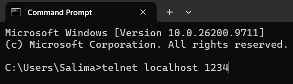

**Connexion du premier client Telnet**

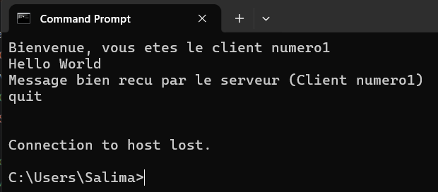

**Connexion simultanée d'un deuxième client**

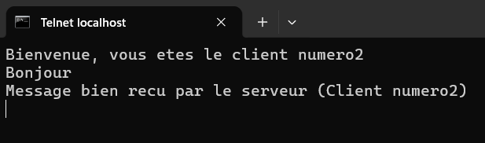

**Affichage des connexions et des messages dans la console serveur**

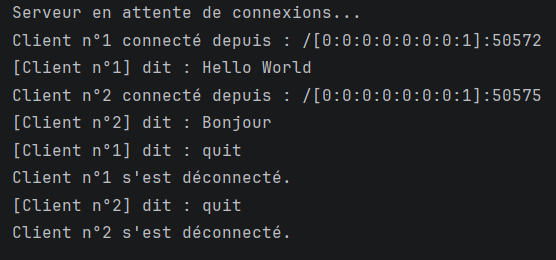

**Résultat :** le test Telnet permet de confirmer que le serveur accepte des connexions TCP et peut communiquer avec plusieurs clients indépendamment de l'implémentation du client Java.

## 2.6. Résultats des tests avec le client Java

### A. Démarrage du serveur

Le serveur démarre et se met en attente des connexions clientes sur le port 1234.

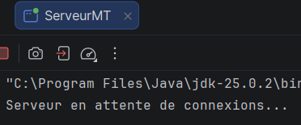

### B. Connexion du premier client

Le premier client établit une connexion avec le serveur et reçoit un message de bienvenue contenant son numéro.

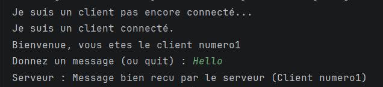

### C. Connexion simultanée de plusieurs clients

Un deuxième client se connecte alors que le premier est toujours actif. Le serveur accepte les deux connexions et attribue un numéro différent à chaque client.

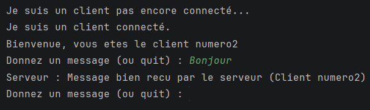

### D. Échange de messages

Les clients envoient des messages au serveur. Celui-ci affiche les messages reçus et renvoie une confirmation à chaque client.

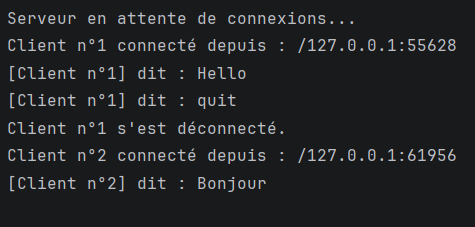

**Bilan de l'activité 3-1 :**

Cette activité permet de vérifier qu'un serveur TCP multithread peut gérer plusieurs connexions clientes indépendantes. Les tests avec le client Java et Telnet permettent également de valider la communication TCP avec différents clients.

# 3. Activité 3-2 : Service de calculatrice et gestion des accès concurrents

## 3.1. Objectifs

Cette activité consiste à étendre le serveur multithread en intégrant un service de calculatrice utilisant la communication par objets Java.

Elle introduit également un compteur global permettant de suivre le nombre total d'opérations calculées par le serveur, tout en garantissant la cohérence de cette ressource partagée grâce à la synchronisation.

## 3.2. Architecture et fonctionnement

Le serveur accepte plusieurs clients sur le port 1234.

Chaque connexion est prise en charge par un thread indépendant de la classe `ClientHandler`.

Le fonctionnement d'une opération est le suivant :

1. Le client saisit deux opérandes et un opérateur.
2. Il crée un objet de la classe `Operation`.
3. L'objet est envoyé au serveur à l'aide de `ObjectOutputStream`.
4. Le serveur récupère l'objet avec `ObjectInputStream`.
5. Le `ClientHandler` extrait les informations de l'opération.
6. Le serveur effectue le calcul demandé.
7. Le résultat est renvoyé au client sous forme d'objet `String`.
8. Le compteur global est incrémenté après chaque calcul réussi.

## 3.3. Classes utilisées

| Classe | Rôle |
|---|---|
| `ServeurMT2.java` | Accepte les connexions et gère le compteur global des opérations. |
| `ClientHandler.java` | Traite les opérations de chaque client dans un thread indépendant. |
| `Operation.java` | Représente une opération mathématique et permet sa transmission sous forme d'objet sérialisable. |
| `ClientMT2.java` | Crée et envoie les opérations au serveur, puis affiche les résultats reçus. |

## 3.4. Communication par objets Java

La classe `Operation` implémente l'interface `Serializable`, ce qui permet de transmettre ses instances entre le client et le serveur.

Elle contient les attributs suivants :

- `operande1` : premier nombre.
- `operateur` : opération mathématique à effectuer.
- `operande2` : deuxième nombre.
- `quitter` : indique si le client souhaite terminer la communication.

Les flux utilisés sont :

- **ObjectOutputStream :** permet d'envoyer les objets.
- **ObjectInputStream :** permet de recevoir les objets.

Le résultat du calcul est ensuite transmis au client sous forme d'une chaîne de caractères sérialisable.

## 3.5. Opérations mathématiques prises en charge

Le service de calculatrice prend en charge quatre opérations :

| Opérateur | Opération | Exemple |
|---|---|---|
| `+` | Addition | 10 + 5 = 15 |
| `-` | Soustraction | 10 - 5 = 5 |
| `*` | Multiplication | 10 × 5 = 50 |
| `/` | Division | 10 / 5 = 2 |

Le serveur gère également les erreurs, notamment la division par zéro et la saisie d'un opérateur non reconnu.

## 3.6. Gestion des accès concurrents

### Problématique

Plusieurs threads `ClientHandler` peuvent exécuter des opérations simultanément.

Ils accèdent tous à une même variable globale : le compteur du nombre total d'opérations calculées.

Sans mécanisme de synchronisation, plusieurs threads pourraient modifier cette variable simultanément, ce qui risquerait de produire des résultats incohérents.

### Solution : synchronisation avec synchronized

Le compteur est déclaré comme une variable statique dans la classe `Serveur`.

Une méthode `synchronized` est utilisée pour effectuer son incrémentation :

```java
private static int compteurOperations = 0;

public static synchronized int incrementerCompteur() {
    compteurOperations++;
    return compteurOperations;
}
```

- `static` permet de partager le même compteur entre toutes les instances des threads.
- `synchronized` garantit qu'un seul thread à la fois peut exécuter cette méthode.

Ainsi, chaque opération calculée avec succès entraîne une incrémentation cohérente du compteur global.

## 3.7. Résultats des tests

### A. Démarrage du serveur

Le serveur démarre et attend les connexions clientes.

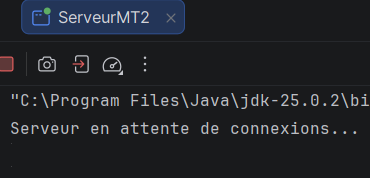

### B. Connexion des clients

Plusieurs clients se connectent au serveur. Chaque client est pris en charge par un thread indépendant.

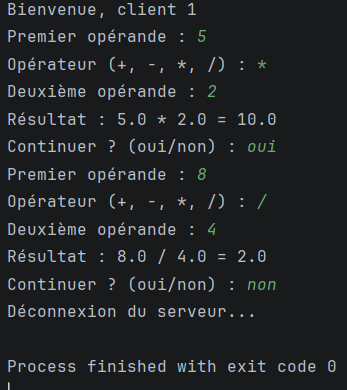

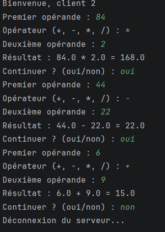

### C. Exécution des opérations

Le client envoie des objets `Operation` contenant les opérandes et l'opérateur. Le serveur effectue les calculs et renvoie les résultats.

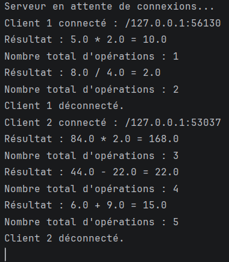

### D. Vérification du compteur global

Plusieurs opérations sont exécutées depuis différents clients. Le serveur affiche le nombre total d'opérations calculées après chaque incrémentation.

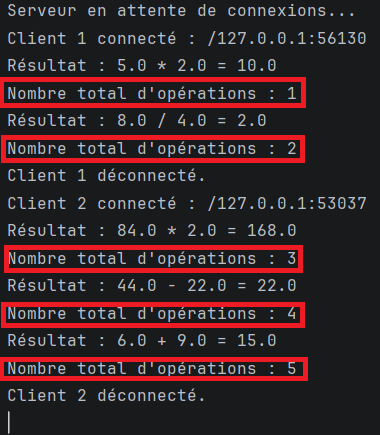

**Bilan de l'activité 3-2 :**

Les tests permettent de vérifier le fonctionnement du service de calculatrice avec plusieurs clients et la cohérence du compteur partagé grâce à la synchronisation.


# 4. Environnement et exécution

## 4.1. Prérequis

- Java Development Kit (JDK) 25.0.2.
- IntelliJ IDEA ou un autre environnement de développement Java.
- Plusieurs instances clientes pour tester les connexions simultanées.

## 4.2. Exécution de l'activité 3-1

1. Ouvrir le projet dans IntelliJ IDEA.
2. Exécuter la classe `Serveur`.
3. Exécuter une ou plusieurs instances de `Client`.
4. Envoyer des messages depuis les clients.
5. Utiliser `quit` pour fermer une connexion cliente.

Pour le test Telnet :

1. Activer le client Telnet sous Windows.
2. Démarrer le serveur Java.
3. Ouvrir une invite de commandes.
4. Exécuter `telnet localhost 1234`.
5. Tester les échanges de messages depuis plusieurs fenêtres Telnet.

## 4.3. Exécution de l'activité 3-2

1. Exécuter la classe `Serveur`.
2. Lancer une ou plusieurs instances de `Client`.
3. Saisir les deux opérandes et l'opérateur.
4. Consulter le résultat retourné par le serveur.
5. Répéter les opérations depuis plusieurs clients.
6. Vérifier l'évolution du compteur global dans la console du serveur.
7. Saisir `non` lorsque le client demande si l'on souhaite continuer pour fermer sa connexion.

**Remarque :** les deux activités utilisent le port 1234. Il faut arrêter le serveur d'une activité avant de lancer celui de l'autre.

# 5. Tests réseau

Les tests locaux permettent de vérifier le fonctionnement du serveur avec plusieurs clients exécutés sur la même machine.

Un test sur un réseau local (LAN) peut également être réalisé en utilisant l'adresse IPv4 de la machine serveur à la place de `localhost`, à condition que les machines soient connectées au même réseau et que le port TCP 1234 soit autorisé dans le pare-feu.

# 6. Conclusion générale

Ce TP a permis de mettre en œuvre plusieurs notions fondamentales du développement d'applications réparties en Java.

La première activité a permis de comprendre le fonctionnement des sockets TCP et la gestion de plusieurs clients à l'aide de threads indépendants. Les tests avec le client Java et Telnet ont permis de vérifier la communication entre le serveur et différents clients.

La deuxième activité a approfondi ces notions à travers la communication par objets Java, l'intégration d'un service de calculatrice et la gestion d'une ressource partagée. L'utilisation de la synchronisation avec `synchronized` a permis de garantir la cohérence du compteur global lors des accès concurrents.

Ces deux activités illustrent l'importance de la communication réseau, de la programmation concurrente et de la synchronisation dans la conception d'applications distribuées.

---

**Réalisé par Salima Fourati — Année universitaire 2026–2027.**